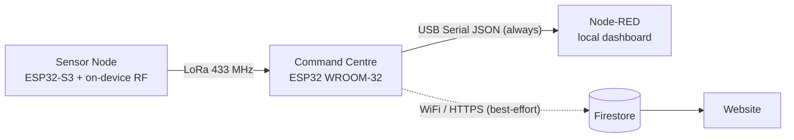

# SENSE-MINE

**AI-Enabled Wireless Surface Mesh Network for Real-Time Mine Subsidence Monitoring, Prediction and Early Warning**


**Smart India Hackathon 2026 — Problem Statement SIH26025**
Organization: Ministry of Coal | Department: Coal India Limited


---

## Table of Contents

1. [Overview](#overview)
2. [Problem Statement](#problem-statement)
3. [Current Build Status](#current-build-status)
4. [Key Features](#key-features)
5. [System Architecture](#system-architecture)
6. [Hardware](#hardware)
7. [Pin Maps](#pin-maps)
8. [AI Pipeline](#ai-pipeline)
9. [Tech Stack](#tech-stack)
10. [Risk Levels](#risk-levels)
11. [Firmware Setup](#firmware-setup)
12. [Command Centre Data Handling](#command-centre-data-handling)
13. [Security Notes](#security-notes)
14. [Known Limitations](#known-limitations)
15. [Roadmap](#roadmap)
16. [Repository Structure](#repository-structure)
17. [References](#references)
18. [Team](#team)

---

## Overview

SENSE-MINE is a low-cost, distributed surface-deformation sensing network designed to be deployed over an underground coal panel. The target design is **six sensor nodes** communicating over a **self-healing multi-hop LoRa mesh** to a command centre, which runs local safety logic and an independent GSM alert path. A connected operator PC hosts the AI pipeline, database, and dashboards.

The system does **not** claim to replace conventional surveying, GNSS, or InSAR. It is positioned as a **dense, continuous, local surface-sensing layer** that complements them, providing high-frequency local deformation observations and immediate local alerts between periodic survey campaigns.

> 📄 Full technical detail: [`SENSE-MINE_Detailed_Project_Report.pdf`](SENSE-MINE_Detailed_Project_Report.pdf). This README is the quick-reference summary.

---

## Problem Statement

> Development of an AI-enabled Low Cost Real Time Mine Subsidence Monitoring, Prediction and Early Warning System for Underground Coal Mines in India.

The PS calls for continuous tilt / relative-distance / crack / vibration monitoring, AI-based anomaly detection and prediction, GIS risk-zone visualization, alerting, offline operation with sync, and scalability.

---

## Current Build Status

This repository holds the **Phase-1 prototype**. The target design (DPR) and what is actually in the current firmware differ in several places. This table is the honest picture.

| Area | Target design (DPR) | Current firmware (Phase-1) |
|---|---|---|
| Nodes | 6-node mesh | **Single-node deployment** |
| Spatial features | Computed from neighbouring nodes | `spatial_displacement_gradient` and `spatial_coherence` are **hardcoded placeholders** (need ≥2 nodes) |
| Random Forest | Backend pipeline | **Runs on the node** (ESP32-S3, compact exported model, 23-feature vector) |
| Node → CC link | Multi-hop mesh | LoRa node → command centre (433 MHz, SX1278) |
| Node location | GPS registered at install | **No GPS hardware yet** — coordinates hardcoded in command-centre firmware (see [GIS note](#gis-location-note)) |
| Cloud/database | FastAPI + PostgreSQL/TimescaleDB | **Firestore** pushed directly by the command centre (best-effort) |
| Offline dashboard | Node-RED | Node-RED fed over **USB Serial JSON** (unconditional path) |
| Command-centre board | ESP32-S3 | **ESP32 DevKitC / WROOM-32** |
| Isolation Forest, XGBoost, risk engine | Full pipeline | Not part of the current firmware; see [Roadmap](#roadmap) |

---

## Key Features

- 🛰️ **Self-healing LoRa mesh** (433 MHz) *(target design)* — neighbour discovery, routing, ACK/retry, automatic route recovery on node failure.
- 📏 **Dual displacement sensing per node** — crack opening + vertical displacement via individually calibrated low-cost potentiometric transducers.
- 📐 **Tilt + vibration** from MPU6050 (raw I²C register driver, no library — clone-chip compatible).
- 🌡️ **Temperature sensing** (DS18B20) for drift compensation.
- 🤖 **Edge AI** — Random Forest deformation-state classifier running directly on the ESP32-S3.
- 🧭 **Spatial fusion engine** *(target design)* — separates a coherent multi-node deformation event from an isolated faulty sensor before any alert.
- 🚨 **Independent, redundant alerting** — local OLED/buzzer, SIM800L SMS + voice call (no internet needed), online dashboard push.
- 🗺️ **GIS risk visualization** — Leaflet + IDW-interpolated risk surface.
- 🔌 **Offline-first** — the USB Serial → Node-RED path never waits on WiFi or cloud.
- 🧱 **Robust data handling** — NaN/Inf readings are emitted as JSON `null`, so a failed sensor can never break the parser.
- ☀️ **Solar + battery powered nodes**, sized against a calculated per-node energy budget.

---

## System Architecture

### End-to-end (target design)

```
                  SURFACE OVER UNDERGROUND PANEL
 +----------------------------------------------------------+
 |  N1 <----------> N2 <----------> N3                        |
 |  ^                ^                ^                       |
 |  v                v                v                       |
 |  N6 <----------> N5 <----------> N4                        |
 +---------------------------+--------------------------------+
                             |
                        LoRa MESH (multi-hop / ACK / retry)
                             v
                  +-----------------------+
                  |    COMMAND CENTRE     |
                  | mesh sink + node      |
                  | health + safety logic |
                  +-----------+-----------+
                              |
                +-------------+-------------+
                |                           |
             SIM800L                   USB / Serial
           SMS + VOICE                       |
                                     Python Backend (PC)
                                              |
                              PostgreSQL / TimescaleDB
                                              |
                              +---------------+---------------+
                          Node-RED (offline)          Web Dashboard (online)
                              |                               |
                             GIS                       AI / History
```

### Current data path (Phase-1)



- The **USB Serial → Node-RED** path is **unconditional**. It never waits on WiFi, Firebase auth, or any network state.
- The **WiFi → Firestore** path is **best-effort**. If WiFi is down or Firebase auth has not completed, the push is skipped (logged to Serial) and the loop continues; LoRa reception is never blocked.
- Firestore plays the role PostgreSQL/TimescaleDB plays in the final design. It can be swapped later without touching node firmware or the LoRa protocol.

---

## Hardware

### Sensor node (× 6 in target design)

| Component | Role |
|---|---|
| ESP32-S3 DevKitC-1 | Node controller + on-device Random Forest inference |
| WH20 linear potentiometer ×2 | Crack opening + vertical displacement |
| MPU6050 (clone) | Tilt (X/Y) + vibration |
| DS18B20 | Temperature (drift compensation) |
| GPS/GNSS module | Installation-time location registration *(planned; not yet in the current build)* |
| SX1278 / RA-02 (433 MHz) | LoRa radio |
| SSD1306 OLED | Local debug/status pages |
| LED + buzzer | Local status interface |
| Solar panel + Li-ion battery | Autonomous power |

### Command centre

| Component | Role |
|---|---|
| ESP32 DevKitC / WROOM-32 | Packet reception, data fan-out, safety logic |
| SX1278 (433 MHz) | LoRa receiver |
| SSD1306 OLED | Local status |
| SIM800L + dedicated GSM power regulator | Independent SMS / voice alert channel |
| USB to operator PC | Serial JSON to Node-RED |

> ⚠️ **SIM800L is a 2G module.** It needs a SIM and network with 2G service at the deployment site. Jio has no 2G. Verify actual 2G availability of your carrier in the deployment region before relying on this path.

> ⚠️ The potentiometric transducers are **low-cost transducers with calibrated mechanical linkage**, not survey-grade geotechnical instruments. Accuracy is established per node via calibration, not assumed.

---

## Pin Maps

### Sensor node (ESP32-S3-DevKitC-1) — frozen

| GPIO | Function | Connected to |
|---|---|---|
| 1 | ADC | Crack-width potentiometer (wiper) |
| 2 | ADC | Vertical-displacement potentiometer (wiper) |
| 4 | 1-Wire | DS18B20 |
| 8 | I²C SDA | MPU6050 + OLED (shared bus) |
| 9 | I²C SCL | MPU6050 + OLED (shared bus) |
| 10 | SPI NSS | SX1278 |
| 11 | SPI MOSI | SX1278 |
| 12 | SPI SCK | SX1278 |
| 13 | SPI MISO | SX1278 |
| 14 | RESET | SX1278 |
| 15 | DIO0 | SX1278 |

### Command centre (ESP32 DevKitC / WROOM-32) — frozen

| GPIO | Function | Connected to |
|---|---|---|
| 18 | SPI SCK (VSPI) | SX1278 |
| 19 | SPI MISO (VSPI) | SX1278 |
| 23 | SPI MOSI (VSPI) | SX1278 |
| 5 | SPI NSS | SX1278 |
| 14 | RESET | SX1278 |
| 26 | DIO0 | SX1278 |
| 21 | I²C SDA | OLED |
| 22 | I²C SCL | OLED |

---

## AI Pipeline

```
Sensor data → Calibration → Feature extraction (23-feature vector)
        │
   ┌────┴────┐
   ▼         ▼
Isolation   Random Forest
 Forest    (deformation state:
(anomaly    STABLE → INITIATION → PROGRESSIVE
 score)     → ACCELERATING → RAPID → STABILIZING)
   │         │
   └────┬────┘
        ▼
 Spatial fusion (gradient + neighbour coherence)
        ▼
 XGBoost short-horizon forecast (10 min / 30 min / 1 h)
        ▼
     Risk Engine (rules, not ML alone)
        ▼
  GREEN / YELLOW / ORANGE / RED
```

The **risk engine**, not the ML models directly, decides whether to escalate, cross-checking sensor health and multi-node spatial agreement first. This prevents a single noisy sensor from triggering a false panel-wide alert.

**What runs where today:**

| Stage | Location | Status |
|---|---|---|
| Random Forest classifier | On-node (ESP32-S3) | In firmware |
| Spatial features | On-node | Placeholders until ≥2 nodes exist |
| Isolation Forest, XGBoost, risk engine | Backend (planned) | Not in current firmware |

---

## Tech Stack

| Layer | Technology |
|---|---|
| Node firmware | ESP32-S3 (Arduino / ESP-IDF), FreeRTOS |
| Edge ML | Compact Random Forest exported to C++ (`model_rf_compact.*`) |
| Mesh radio | LoRa (SX1278/RA-02), custom HELLO/ROUTE/DATA/ACK/RETRY/HEARTBEAT protocol |
| Command-centre firmware | ESP32 (WROOM-32), packet management, local safety logic |
| Phase-1 cloud | Firebase Auth + Firestore (REST over WiFi/HTTPS) |
| Backend (final design) | Python, FastAPI |
| Database (final design) | PostgreSQL + TimescaleDB |
| Offline dashboard | Node-RED + node-red-dashboard |
| Online dashboard | React + TypeScript |
| GIS | Leaflet + OpenStreetMap, IDW interpolation |
| AI/ML | scikit-learn (Isolation Forest, Random Forest), XGBoost |
| Alerts | SIM800L (SMS + voice call) |

---

## Risk Levels

| Level | Meaning |
|---|---|
| 🟢 GREEN | Normal |
| 🟡 YELLOW | Early abnormality, single-node / low confidence |
| 🟠 ORANGE | Persistent, spatially coherent deformation |
| 🔴 RED | Rapid/accelerating deformation, multi-node confirmed |

---

## Firmware Setup

### Sensor node — `sennse_mine_node_final/sense_mine_node_final.ino`

**Board:** ESP32-S3-DevKitC-1

**Libraries (Library Manager):**
- LoRa by sandeepmistry
- OneWire
- DallasTemperature
- Adafruit GFX Library
- Adafruit SSD1306

MPU6050 uses **no library** (raw I²C register driver for the clone chip).

**Files that must sit in the same sketch folder:**

| File | Note |
|---|---|
| `model_rf_compact.cpp` | Use the **fixed** version. The raw export contains ~36,889 malformed float literals (`0f` instead of `0.0f`) that will not compile. Only literal tokens were changed; no tree structure changed. |
| `model_rf_compact.h` | Unchanged from export |
| `preprocessing_rf.h` | Fixed version (same `0f` bug, one instance, on the acceleration feature's median) |
| `secrets.h` | Local credentials/config. **Do not commit real values.** |

> ❌ **Do NOT add `feature_config_compact.h`** to this sketch folder. It declares its own `rf_compact::kClassNames`, which conflicts with the one in `model_rf_compact.h/.cpp` and breaks the build. The firmware takes class names from `model_rf_compact.h` and keeps its own small local feature-name list for Serial debug output.

**Arduino IDE settings (required):**
The compact model is about 1 MB of flash-resident data. Under **Tools → Partition Scheme**, choose a scheme with a large app partition, e.g. **"Huge APP (3MB No OTA/1MB SPIFFS)"**, and use a board variant with **≥ 4 MB flash** (8/16 MB preferred). The default partition scheme **will overflow**.

### Command centre — `sennse_mine_command_centre_final003.ino`

**Board:** ESP32 DevKitC / WROOM-32

**Libraries:** LoRa (sandeepmistry), Adafruit GFX, Adafruit SSD1306, plus WiFi, WiFiClientSecure, HTTPClient (bundled with the ESP32 core).

**Edit before flashing:**

```cpp
#define WIFI_SSID            "WIFI NAME HERE"
#define WIFI_PASSWORD        "WIFI PASSWORD HERE"
#define FIREBASE_API_KEY     "FIREBASE_API_KEY"
#define FIREBASE_PROJECT_ID  "FIREBASE_PROJECT_ID"
#define DEVICE_EMAIL         "Device Email"
#define DEVICE_PASSWORD      "Device Password"
```

The USB → Node-RED path works with none of the WiFi/Firebase values filled in.

**One-time Firebase setup (device account, "Option B"):**
1. Firebase Console → Authentication → Sign-in method → enable **Email/Password** and **Anonymous**.
2. Authentication → Users → **Add user** using the same email/password as `DEVICE_EMAIL` / `DEVICE_PASSWORD`. It is a fixed identity string, not a real mailbox.
3. Firestore rules check that `request.auth.token.email` equals that fixed address, so only this board can **write**. Anonymous website visitors have `auth != null` but no email claim, so they can **read only**.

---

## Command Centre Data Handling

### Invalid-reading handling

The node can legitimately send `NaN` (e.g. `tilt_x`/`tilt_y` when the MPU read fails, `temperature_C` when the DS18B20 disconnects). Arduino prints NaN as the literal `nan`, which is **not valid JSON** and made Node-RED's `JSON.parse()` throw.

Fix: every numeric value emitted over **both** the USB and Firestore paths goes through `jsonNum()`, which converts NaN/Inf into JSON `null`. A top-level `data_quality` field (`"OK"` / `"PARTIAL"`) lets Node-RED and the website flag a degraded reading without the parse ever failing.

### GIS location note

There is no GPS hardware yet, so each node's install location is **hardcoded** in the command-centre firmware to the geographic centroid of the **Pachhwara North coal block, Pakur District, Jharkhand** (bounding box 24°32'12.771"N–24°33'53.683"N, 87°25'18.208"E–87°29'55.417"E). It is a real, named Coal India-linked site used as a **reference/target deployment** for the demo narrative.

**This is not where the physical testbed sits** (that is the lab/college). `location_source` and `site_label` in every record say so explicitly, so Node-RED, the website, or anyone reading raw Firestore data cannot mistake it for a real GPS fix from hardware installed at Pachhwara North.

---

## Security Notes

- `WiFiClientSecure` uses `setInsecure()` (no certificate pinning) as an accepted **Phase-1 shortcut**. Pin Google's root CA or use the ESP32 core certificate bundle before any real deployment.
- Never commit real WiFi passwords, Firebase API keys, or device credentials. Add `secrets.h` to `.gitignore`, and rotate any key that has ever been pushed to a public repository.
- Firestore writes must stay restricted to the device account via security rules.

---

## Known Limitations

- Scaled prototype/testbed validation, not a geomechanical replica of an underground mine.
- No real mine field dataset used for AI training; only clearly-labelled synthetic and testbed data.
- Current build is a **single node**; spatial gradient/coherence features are placeholders, so multi-node confirmation logic is not yet exercised.
- Short-horizon (10 min–1 h) trend forecasting only; no multi-hour/day-scale absolute forecast claimed.
- GIS is a Leaflet overlay with hardcoded/surveyed local coordinates, not satellite-grade GIS; the IDW risk surface is an estimate between sensor points, not a measurement everywhere.
- Phase-1 cloud uses Firestore with insecure TLS client (see [Security Notes](#security-notes)).
- SIM800L requires 2G service (Airtel/Vi/BSNL, subject to local coverage); not compatible with Jio.
- No OTA model deployment for this build; model updates are validated and flashed via USB.

Full list with rationale: §19 of the Detailed Project Report.

---

## Roadmap

Legend: ✅ done · 🟡 started in current firmware · ⬜ not started

- 🟡 **Phase 1** — One production-quality node validated continuously
- ⬜ **Phase 2** — Replicate to all 6 nodes
- ⬜ **Phase 3** — Mesh protocol + route-recovery test
- ⬜ **Phase 4** — Per-node sensor calibration
- 🟡 **Phase 5** — Command-centre firmware + SIM800L integration
- 🟡 **Phase 6** — Backend + database (Firestore interim; Python + PostgreSQL/TimescaleDB planned)
- 🟡 **Phase 7** — AI layer (Random Forest on-node; Isolation Forest + XGBoost pending)
- ⬜ **Phase 8** — Risk engine (AI + spatial coherence + sensor health)
- 🟡 **Phase 9** — Node-RED offline dashboard
- 🟡 **Phase 10** — Online web dashboard
- ⬜ **Phase 11** — GIS integration (full IDW risk surface)
- ⬜ **Phase 12** — 24–72 h endurance test

Future upgrades (independent geophone, GNSS-RTK, InSAR/SBAS integration, 4G/LTE module, OTA deployment, field validation with a mine/research institution) are tracked in DPR §20.

---

## Repository Structure

```text
SENSE-MINE/
│
├── sennse_mine_node_final/
│   ├── sense_mine_node_final.ino          # Final sensor-node firmware (edge AI)
│   ├── secrets.h                          # Local config (do not commit real values)
│   ├── model_rf_compact.cpp               # Fixed RF model (0f → 0.0f)
│   ├── model_rf_compact.h
│   └── preprocessing_rf.h                 # Fixed preprocessing constants
│
├── README.md
├── SENSE-MINE_Detailed_Project_Report.pdf
├── sennse_mine_command_centre_final003.ino  # Final command-centre firmware
├── sennse_mine_command_centre_test.ino      # Test code
└── sennse_mine_node_test.ino                # Test code
```

---

## References

1. SIH 2026 — Problem Statement SIH26025, Ministry of Coal / Coal India Limited
2. Underground coal mine monitoring with wireless sensor networks — HKUST Research Portal
3. Integrated high-precision surface subsidence monitoring using D-InSAR, SBAS, and UAV — *Scientific Reports* (Nature)
4. Land surface deformation monitoring by microwave SAR data analysis in the coal mines of Chhattisgarh — ISTI Portal
5. Monitoring 3D surface deformation in mining areas combining SBAS-InSAR, GNSS and the Probability Integral Method — PMC
6. Application of wireless sensor networks for environmental monitoring in underground coal mines: A systematic review — ScienceDirect
7. DGMS Annual Report 2024, Directorate General of Mines Safety

---

## Team

**Team-Nirvana**

**Institution:** Guru Gobind Singh Indraprastha University, Delhi — University School of Automation & Robotics (USAR)
**Institute Code (AISHE):** U-0099
**Event:** Smart India Hackathon 2026 Nomination

| Name | Position | Branch | Batch | Role |
|---|---|---|---|---|
| Paras Bhatia | Team Leader | B.Tech IIoT | 2024 | Backend Development |
| Lakshya | Team Member | B.Tech IIoT | 2024 | Embedded and IoT Development |
| Aditya | Team Member | B.Tech AIML | 2024 | Edge AI Development |
| Navneet | Team Member | B.Tech IIoT | 2024 | Frontend Development |
| Kundan | Team Member | B.Tech IIoT | 2024 | Research and Development |
| Deepti | Team Member | B.Tech AIML | 2026 | Research and Development |

**Mentor:** Dr. Khyati Chopra, Assistant Professor, GGSIPU, USAR

**Problem Statement:** SIH26025 — Ministry of Coal / Coal India Limited
